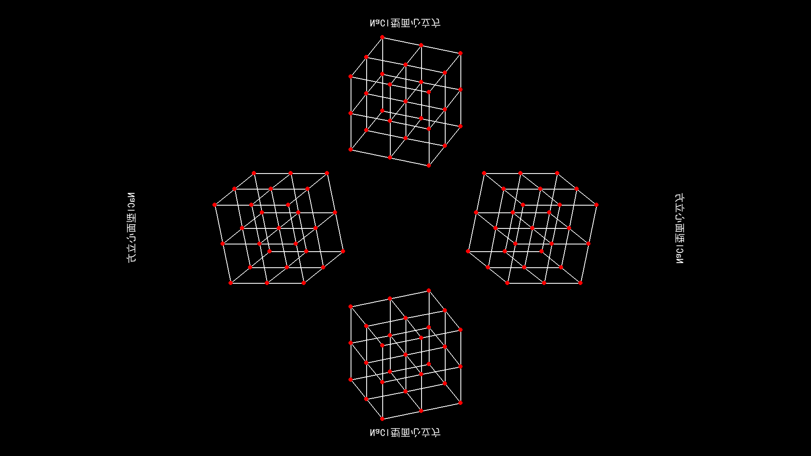

# 晶体结构三维演示

用 Pygame 把一个晶胞同时画成四个视角，形成环绕的立体观感，用来讲解
简单立方、体心立方、面心立方、六方最密堆积等常见晶体结构。

支持 **键盘 / 手势 / 语音 / MQTT** 四种切换方式，所有参数都在 `config.yaml`
里，改参数不需要动代码。没有摄像头、没有麦克风也能跑（`--no-camera`）。



---

## 目录

- [功能特性](#功能特性)
- [快速开始](#快速开始)
- [运行方式](#运行方式)
- [操作说明](#操作说明)
- [参数配置](#参数配置)
- [数据文件与新增晶胞](#数据文件与新增晶胞)
- [项目结构](#项目结构)
- [相关仓库](#相关仓库)
- [常见问题](#常见问题)
- [开发](#开发)

---

## 功能特性

- **7 种晶胞**：简单立方堆积、CsCl 型体心立方、ZnS 型面心立方、NaCl 型面心立方、
  六方最密堆积、Cu 面心立方、CaF₂ 型
- **四视图同步旋转**：同一晶胞在屏幕四个方位各画一份，姿态不同，立体感更强
- **切换过渡**：换晶胞时线条、原子、文字先渐隐到黑，换完再渐显，不会突兀
- **四种输入**：
  - 键盘 `F1`~`F7` 直接选，`ESC` 退出
  - 摄像头手势：手腕左右移动切换
  - 语音：说"下一个 / 上一个"
  - MQTT：手机 APP 或物联网平台远程发指令
- **配套手机 App**：独立的 Android 遥控器仓库
  [crystal-viewer-remote](https://github.com/ysy0817/crystal-viewer-remote)，点按钮即可远程发指令
- **语音介绍**：收到 `introduce` 指令后朗读当前晶胞的讲解文字
- **参数全部外置**：窗口、颜色、缩放、转速、灵敏度、密钥都在配置文件里
- **可选依赖**：缺 `mediapipe` / `pyaudio` 只会禁用对应功能，程序照常运行

---

## 快速开始

### 环境要求

- Python **3.9+**（推荐 **3.10 ~ 3.12**，`mediapipe` 对 3.12 支持最稳）
- Windows / macOS / Linux 均可（本仓库主要在 Windows 上开发）

### 安装

```bash
git clone <你的仓库地址>
cd crystal-viewer

python -m venv .venv

# Windows
.venv\Scripts\activate
# macOS / Linux
source .venv/bin/activate

pip install -r requirements.txt
```

需要手势和语音时再装可选依赖：

```bash
pip install -r requirements-full.txt
```

### 配置密钥（可选，可跳过）

只有语音识别、语音合成、MQTT 遥控需要密钥；纯键盘演示完全用不到。

```bash
copy keys.example.yaml keys.yaml     # Windows
cp keys.example.yaml keys.yaml       # macOS / Linux
```

然后编辑 `keys.yaml` 填自己的 Key。该文件已被 `.gitignore` 忽略，不会提交；
`config.yaml` 里的密钥字段一律留空。

### 跑起来

```bash
pip install -e .
python -m crystal_viewer
```

或者不安装，直接用脚本（会自动把 `src` 加进 `PYTHONPATH`）：

```bash
run.bat            # Windows
./run.sh           # macOS / Linux
```

没有摄像头就先关掉摄像头功能：

```bash
run.bat --no-camera
```

### 先自检一下

```bash
python -m crystal_viewer --check        # 配置、数据、依赖是否就绪
python -m crystal_viewer --list-models  # 列出所有晶胞
```

`--check` 会打印配置文件位置、晶格点数量、晶胞数量、密钥是否填写、
以及可选依赖（opencv / mediapipe / pyaudio / paho-mqtt）是否安装。

---

## 运行方式

| 命令 | 说明 |
| --- | --- |
| `python -m crystal_viewer` | 正常启动（需先 `pip install -e .`） |
| `crystal-viewer` | 同上，安装后生成的命令 |
| `run.bat` / `./run.sh` | 免安装启动 |
| `python -m crystal_viewer --no-camera` | 无摄像头 |
| `python -m crystal_viewer --no-voice --no-mqtt` | 只保留键盘 |
| `python -m crystal_viewer --model caf2` | 直接从 CaF₂ 开始（也可写序号 `7`） |
| `python -m crystal_viewer --windowed 1280x720` | 临时改窗口大小 |
| `python -m crystal_viewer --render-once out.png` | 离屏渲染一张图后退出（服务器上也能用） |
| `python -m crystal_viewer --check` | 自检 |
| `python -m crystal_viewer -v` | 显示更多日志（`-vv` 更详细） |

窗口过大可以用 `--windowed 1280x720`，或直接改 `config.yaml` 里的 `window.width/height`。

---

## 操作说明

### 键盘

| 按键 | 作用 |
| --- | --- |
| `F1` ~ `F7` | 切换到第 1~7 个晶胞（顺序见 `models.yaml`） |
| `ESC` | 退出 |
| `Q`（摄像头窗口） | 关闭摄像头窗口 |

按键映射在 `config.yaml` 的 `keyboard` 段，可以改成别的键（例如 `1`、`space`）。

### 手势

手掌朝向摄像头，手腕**左右横向移动**超过阈值就切换。灵敏度由这两个参数控制：

- `gesture.switch_threshold`：位移阈值，**调小更灵敏**（默认 2.0）
- `gesture.warmup_frames`：启动后要连续看到多少帧才开始响应，防误触（默认 10）

摄像头画面窗口标题是 `camera`，按 `q` 关闭。不想要这个窗口就把
`gesture.show_window` 改成 `false`。

### 语音

语音识别由 MQTT 消息 `turn` 触发（也可以给 `keyboard.voice_key` 绑定一个按键）：

1. 程序录 5 秒音（`voice.duration`）
2. 上传百度语音识别
3. 听到"下一个 / 上一张"之类的词就切换

可识别的词在 `voice.next_phrases` / `voice.prev_phrases` 里配置，
判断时会先去掉标点和空格，所以"下一个。"和"下一个"等价。

> 语音识别需要百度智能云的 API Key，见 [参数配置](#参数配置) 里的 `asr` 段。

### MQTT 远控

订阅 `mqtt.topic`，收到以下字符串执行对应动作：

| 指令 | 动作 |
| --- | --- |
| `+1` | 下一个晶胞 |
| `-1` | 上一个晶胞 |
| `0` ~ `6` | 直接跳到第 1~7 个晶胞（序号从 0 开始，超出范围忽略） |
| `start` | 开始 / 恢复自动旋转 |
| `stop` | 停止自动旋转 |
| `turn` | 触发一次语音识别 |
| `introduce` | 朗读当前晶胞的介绍 |

指令字符串在 `mqtt.commands` 里改；数字跳转由 `mqtt.numeric_select` 开关控制。
用 DFRobot IoT 平台或任意 MQTT 客户端往对应 Topic 发这些字符串即可。

### 配套手机 App（独立仓库）

桌面程序本身没有手机界面。配套的 Android 遥控器单独放在**另一个仓库**里：

**https://github.com/ysy0817/crystal-viewer-remote**

- 四个功能按钮：开始 / 停止 / 语音介绍 / 录音
- 7 个数字按钮：`0` ~ `6`
- Broker、Topic、账号密码填在 App 自己的 `keys.properties`，与本仓库完全独立
- 构建与使用说明见该仓库的 README

它本质上只是往同一个 MQTT Topic 发字符串。所以不装 App、直接用任何 MQTT 客户端
（MQTTX、手机 MQTT 工具等）发送上表中的指令，效果完全一样。

---

## 参数配置

**所有可调参数都在 `config.yaml`，文件里每一项都有中文注释。**
改完保存，重新运行程序即可生效。

### 常用参数速查

| 想要的效果 | 改哪里 | 默认值 |
| --- | --- | --- |
| 窗口大小 | `window.width` / `window.height` | 1920 / 1080 |
| 帧率 | `window.fps` | 60 |
| 背景色 | `window.background` | `black` |
| 晶胞大小 | `render.scale` | 100 |
| 棱线粗细 | `render.line_width` | 2 |
| 原子圆点大小 | `render.point_radius` | 5 |
| 名称字体 / 字号 | `render.font_name` / `render.font_size` | `simhei` / 24 |
| 名称是否镜像 | `render.label_flip_vertical` | `true`（设计如此） |
| 棱线颜色 | `render.line_color` | `0xFFFFFF` |
| 原子颜色 | `render.point_color` | `0xFF0000` |
| 文字颜色 | `render.text_color` | `0xFFFFFF` |
| 渐隐快慢 | `render.*_fade_step` | `0x111111`（越大越快） |
| 旋转速度 | `views[].spin.deg` | 2（度/帧） |
| 启动时是否自动旋转 | `rotation.auto` | `true` |
| 视图离屏幕中心的距离 | `views[].offset` | 300 像素 |
| 模型名称位置 | `views[].label_offset` | 左右 350 / 上下 185 |
| 名称旋转角度 | `views[].label_rotation` | 90 / 270 / 0 / 0 |
| 手势灵敏度 | `gesture.switch_threshold` | 2.0 |
| 摄像头编号 | `gesture.camera_index` | 0 |
| 录音时长 | `voice.duration` | 5 秒 |

### 颜色写法

颜色统一用 `0xRRGGBB`：`0xFF0000` 红、`0x00FF00` 绿、`0xFFFFFF` 白、`0x000000` 黑。

### 关闭某项功能

```yaml
gesture:
  enabled: false     # 不用摄像头
voice:
  enabled: false     # 不用语音识别
tts:
  enabled: false     # 不用语音介绍
mqtt:
  enabled: false     # 不用远程遥控
```

### 密钥怎么放（重要）

**所有密钥都写在 `keys.yaml` 里，`config.yaml` 中对应字段一律留空。**

```yaml
# keys.yaml —— 已被 .gitignore 忽略，不会传到 GitHub
asr:                      # 百度语音识别（说"下一个 / 上一个"）
  api_key: "你的 Key"
  secret_key: "你的 Secret"
tts:                      # 百度语音合成（朗读晶胞介绍）
  api_key: "你的 Key"
  secret_key: "你的 Secret"
mqtt:                     # DFRobot IoT 遥控
  topic: "你的 Topic"
  username: "你的用户名"
  password: "你的密码"
```

首次使用先复制模板：`copy keys.example.yaml keys.yaml`（macOS/Linux 用 `cp`）。
某一项留空，对应功能就会自动关闭，不影响键盘演示。

也可以用环境变量覆盖（适合 CI / 服务器），格式是 `CRYSTAL_<段>__<键>`：

| 环境变量 | 作用 |
| --- | --- |
| `CRYSTAL_ASR__API_KEY` / `CRYSTAL_ASR__SECRET_KEY` | 语音识别 |
| `CRYSTAL_TTS__API_KEY` / `CRYSTAL_TTS__SECRET_KEY` | 语音合成 |
| `CRYSTAL_MQTT__PASSWORD` | MQTT 密码 |

任意配置项都能这样临时覆盖：

```bash
CRYSTAL_RENDER__LINE_WIDTH=4 python -m crystal_viewer
CRYSTAL_GESTURE__ENABLED=false python -m crystal_viewer
```

---

## 数据文件与新增晶胞

一种晶胞 = **棱线文件 + 介绍文本 + `models.yaml` 里的一条记录**，不需要改代码。

### 1. 晶格点（全项目共用）

`data/lattice/unit_cell_points.csv`：所有可能的原子位置，单位是"半个晶胞棱长"。

```csv
x,y,z
-1,-1,-1
1,-1,-1
...
```

编号从 **0** 开始，按行顺序编号。立方体 8 个顶点是 0~7，
面心、体心、棱中点等依次往后排。

### 2. 棱线文件

`data/edges/<key>.csv`：每行两个编号，表示这两个原子之间连一条线。

```csv
s1,s2
0,1
0,3
...
```

### 3. 介绍文本

`data/intro/<key>.txt`：一段中文讲解，供 `introduce` 指令朗读。

### 4. 在 `models.yaml` 登记

```yaml
models:
  - key: my_crystal          # 英文标识，同时决定默认文件名
    name: 我的晶胞            # 屏幕上显示的名字
    edges: data/edges/my_crystal.csv   # 可省略，默认 data/edges/<key>.csv
    intro: data/intro/my_crystal.txt   # 可省略，默认 data/intro/<key>.txt
```

**顺序就是 `F1`、`F2`……的顺序**。加完运行 `--list-models` 检查一下，
如果有编号越界（比如棱线写了 99 但只有 24 个点），会直接报错并告诉你越界在第几行。

---

## 项目结构

```
crystal-viewer/
├── config.yaml              # ★ 主配置文件：所有参数都在这里
├── keys.yaml                # ★ 你的密钥，不提交（从模板复制）
├── keys.example.yaml        #   密钥模板
├── models.yaml              # ★ 晶胞清单：增删晶胞改这里
├── requirements.txt         # 最小依赖
├── requirements-full.txt    # 含手势/语音的完整依赖
├── pyproject.toml           # 打包配置，提供 crystal-viewer 命令
├── run.bat / run.sh         # 免安装启动脚本
├── data/
│   ├── lattice/             # 晶格点坐标
│   ├── edges/               # 各晶胞的棱线
│   └── intro/               # 各晶胞的介绍文本
├── docs/
│   ├── geometry.md          # 旋转与斜投影的数学原理
│   └── preview.png          # 预览图
├── src/crystal_viewer/
│   ├── cli.py               # 命令行入口
│   ├── config.py            # 配置加载（默认值→yaml→local→环境变量）
│   ├── models.py            # 晶胞数据加载与校验
│   ├── geometry.py          # 旋转矩阵、斜投影
│   ├── renderer.py          # pygame 绘制封装
│   ├── effects.py           # 颜色渐变
│   ├── app.py               # 主循环、输入事件、切换逻辑
│   └── services/
│       ├── gestures.py      # 摄像头手势
│       ├── recorder.py      # 录音
│       ├── asr.py           # 百度语音识别
│       ├── tts.py           # 百度语音合成
│       └── mqtt_link.py     # MQTT 遥控
└── tests/                   # pytest 单元测试
```

---

## 常见问题

**`mediapipe` 装不上**
换成 Python 3.10~3.12 的虚拟环境；3.13+ 部分版本还没有 wheel。急着用就先
`python -m crystal_viewer --no-camera`。

**`pyaudio` 装不上（Windows）**
```bash
pip install pipwin
pipwin install pyaudio
```
或者直接关闭语音功能。

**中文显示成方块**
系统里没有 `simhei`（黑体）。把 `render.font_name` 改成系统里存在的中文字体，
例如 macOS 用 `PingFang SC`、Linux 用 `Noto Sans CJK SC`。字体缺失时会自动退回默认字体。

**窗口比屏幕大 / 显示不全**
改 `window.width`、`window.height`，或用 `--windowed 1600x900`。
注意四视图布局是按 1920×1080 设计的：窗口调小后上下两个晶胞和名称可能被裁掉，
这时需要同步调小 `views[].offset`（默认 300）和 `views[].label_offset`。

**摄像头打不开**
可能被其他程序占用（微信、腾讯会议等），或编号不对。改 `gesture.camera_index`
试 `1`、`2`，或直接 `--no-camera`。

**语音没反应**
先看 `--check` 里"识别密钥"是否为 OK；再看日志有没有 `百度语音识别返回错误`。
常见原因：Key 失效、没开通"短语音识别"能力、麦克风没权限。

**MQTT 连不上**
检查 `keys.yaml` 里的 topic / 用户名 / 密码，以及 `mqtt.host`、`mqtt.port`。
连接失败只会禁用遥控功能，不影响本机演示。

**服务器 / 没有显示器怎么出图**
```bash
python -m crystal_viewer --render-once docs/preview.png --render-steps 8
```
它会自动使用 SDL 的 dummy 视频驱动，不需要真实显示器。

---

## 开发

```bash
pip install -e ".[dev]"
pytest
```

代码分层：`config`（读配置）→ `models`（读数据）→ `geometry`（算坐标）
→ `renderer`（画）→ `app`（串起来），`services/` 放外部依赖。
`geometry`、`config`、`effects`、`models` 都不依赖 pygame，可以单独测试。

改动渲染公式前建议先看 [docs/geometry.md](docs/geometry.md)。

---

## 相关仓库

| 仓库 | 内容 |
| --- | --- |
| [crystal-viewer](https://github.com/ysy0817/crystal-viewer) | 本仓库：桌面端四视图晶体结构演示（Python + Pygame） |
| [crystal-viewer-remote](https://github.com/ysy0817/crystal-viewer-remote) | Android 遥控器 App（Kotlin / Java + MQTT），通过 MQTT 远程控制本程序 |

两个仓库相互独立，密钥各管各的：本仓库用 `keys.yaml`，App 用 `keys.properties`。

---

## 许可

本仓库暂未指定开源许可证。如果要让别人自由使用，建议补一个 `LICENSE`
（例如 MIT）。
